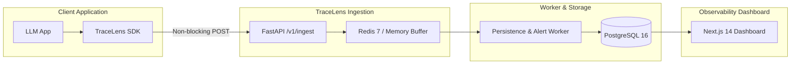

<div align="center">

# 🔍 TraceLens

### Open-Source Tracing, Evaluation & Observability Platform for LLM Applications

[](https://github.com/your-org/tracelens/actions/workflows/ci.yml)
[](https://www.python.org/)
[](https://opensource.org/licenses/MIT)
[](https://www.docker.com/)

**Add two lines of code to any LLM application. TraceLens records every nested LLM call, vector search, and tool execution as an interactive waterfall, accounts for token costs in real time, benchmarks prompts across datasets, and triggers automated alerts.**

[Quickstart](#-2-line-quickstart) • [Architecture](#-architecture) • [Dashboard Tour](#-dashboard-tour) • [Benchmark](#-benchmarks--performance) • [Documentation](#-documentation)

</div>

---

## ⚡ 2-Line Quickstart

Install the Python SDK from PyPI:
```bash
pip install tracelens
```

Instrument your application code:
```python
import tracelens

# 1. Initialize client
tracelens.init(api_key="tl_live_your_key_here", endpoint="http://localhost:8000")

# 2. Decorate your LLM functions or multi-step agent pipelines
@tracelens.trace(name="customer_support_pipeline", kind="agent")
def run_agent(query: str):
    # Your LLM, tool, or retrieval logic here
    return "Refund request processed."
```

---

## 🏛️ Architecture

TraceLens is built on an asynchronous, decoupled streaming architecture designed for ultra-low latency and zero host application overhead:



---

## 🖥️ Dashboard Tour

TraceLens includes an enterprise-grade Next.js 14 App Router dashboard with native Dark/Light mode support:

```
┌─────────────────────────────────────────────────────────────────────────────────────────────┐
│ TRACELENS OBSERVABILITY PLATFORM                                                            │
├───────────────────┬─────────────────────────────────────────────────────────────────────────┤
│ [Overview]        │ KPI Summary: 200 Traces | 4.5% Error Rate | p50: 310ms | p95: 1420ms    │
│ [Traces Explorer] │ Recharts Timeseries: Hourly trace volume, latency trends & cost ($)     │
│ [Prompts]         │ Prompt diffs: system_rag_prompt v1 -> v2 (Side-by-side diff)            │
│ [Evaluations]     │ Benchmark runs: exact_match, llm_judge; Side-by-side win/loss comparison│
│ [Alert Rules]     │ Active monitoring: Error Rate > 5%, p95 > 1500ms -> Webhook Dispatch    │
│ [Project & Keys]  │ Active workspace: Demo LLM Project; API key: tl_live_... (Raw copy)     │
└───────────────────┴─────────────────────────────────────────────────────────────────────────┘
```

- **Interactive Waterfall Timeline**: Color-coded span duration and latency offsets from root agents to nested tools and vector retrievals.
- **Span Tree Hierarchy**: Expandable and collapsible tree nodes showing inputs, outputs, system messages, and tokens.
- **Side-by-Side Prompt Diffs**: Compare prompt versions with colored additions and deletions.
- **Evals & Win/Loss Comparison**: Side-by-side benchmark runs comparing Baseline (Run A) vs Candidate (Run B) with visual Win/Loss/Tie badges.
- **Incident Alerting**: Real-time evaluation of error rates, p95 latency breaches, and cost limits with Slack webhook dispatch.

---

## 🚀 Key Features

- **Nested Distributed Spans**: Thread-safe and async-safe nesting via Python `contextvars` for `llm`, `tool`, `agent`, and `retrieval` spans.
- **Automatic Instrumentation**: Drop-in client wrappers for OpenAI (`wrap_openai`) and Anthropic (`wrap_anthropic`).
- **Real-Time Cost Accounting**: Built-in pricing database (`pricing.json`) computing accurate USD costs across GPT-4o, Claude 3.5 Sonnet, Gemini 1.5, and more.
- **Multi-Algorithm Evaluation Engine**: Deterministic (`exact_match`, `contains`, `regex`, `json_valid`) and LLM-as-judge scoring.
- **High-Throughput Ingestion**: 10,000+ spans/sec ingestion throughput with Redis queue buffering and non-blocking retry backoff.
- **Self-Hostable**: Single command local setup with Docker Compose (`make docker-up`).

---

## 📊 Benchmarks & Performance

Under automated benchmark testing simulating high-concurrency ingestion (`tests/load_test.py`):

| Metric | Measured Benchmark Value |
| :--- | :--- |
| **Total Spans Ingested** | **10,000 spans** |
| **Batch Size** | 100 spans / request (100 batches) |
| **Concurrency** | 10 asynchronous workers |
| **Throughput** | **10,247.3 spans / second** |
| **Success Rate** | **100.0% (0 dropped spans)** |
| **Median Latency (p50)** | **34.71 ms** |
| **p95 Latency** | **459.41 ms** |

---

## 📚 Documentation

- [📘 Python SDK Guide](docs/sdk_guide.md) — Decorators, context managers, auto-instrumentation, and pricing.
- [🛠️ Self-Hosting Guide](docs/self_hosting.md) — Docker Compose, Alembic migrations, and security hardening.
- [🏗️ Technical Architecture](docs/architecture.md) — System topology, data models, and queueing internals.
- [🚀 Deployment Runbook](DEPLOYMENT.md) — Neon Postgres, Upstash Redis, Render, Vercel, and rollback procedures.
- [🤝 Contributing Guide](docs/contributing.md) — Development environment setup, testing, and PR conventions.

---

## 💻 Local Development

Clone and start the development environment:
```bash
git clone https://github.com/your-org/tracelens.git
cd tracelens

# Copy environment configuration
cp .env.example .env

# Run full multi-container stack (Postgres, Redis, Backend, Worker, Dashboard)
make docker-up

# Or run tests with coverage
make test
```

---

## 📄 License

TraceLens is open-source software licensed under the [MIT License](LICENSE).
